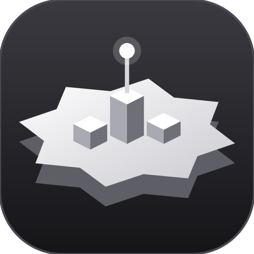

<p align="center">
  
</p>

# Agents World

**See all your AI sessions in one place, and get told the moment one finishes.**

Agents World is a local web app for people who use AI coding agents. It finds your **Claude Code**, **Codex** and **OpenCode** sessions (also the ones you started in a normal terminal) and shows them as a small 3D world: every project is an island, every session a building, and a robot works, waits or sleeps depending on what the agent is doing. When a session finishes, you get a desktop notification. There is also a chat page to read and continue any session, two manager agents (Bella and Interstellar) who can start other agents for you, an overnight Research Lab and an optional Today page.

Everything runs on your own computer. Nothing is sent anywhere except what the agents themselves send to their AI providers.

## What you need
- **Node.js 22.5 or newer** (from https://nodejs.org).
- At least one of these, installed and logged in: **Claude Code** (`claude`), **Codex** (`codex`), **OpenCode** (`opencode`). Agents World reads their session files and starts them for you. It does not have its own AI account. See "Which subscription do I need?" below.
- macOS or Windows. Linux works too, but desktop notifications and "open in terminal" are skipped there.

## Which subscription do I need?
**One is enough.** Agents World never asks for your password or API key: it runs the AI programs you already use, logged in with your own account.

| You have | Install | Log in | What you get |
|---|---|---|---|
| Claude Pro or Max | Claude Code: `curl -fsSL https://claude.ai/install.sh \| bash` (Windows PowerShell: `irm https://claude.ai/install.ps1 \| iex`) | run `claude` and log in in the browser | You get **Bella**, your manager, plus the Agent Guild and the Research Lab. |
| ChatGPT Plus or Pro | Codex: `npm install -g @openai/codex` | run `codex` and choose "Sign in with ChatGPT" | You get **Interstellar**, your partner. The Agent Guild and the Research Lab need Claude Code. |
| Both | both of the above | both | You get both, and the Family chat where they talk together. |

The free Claude plan does not include Claude Code. OpenCode works for plain chats too, but Bella and Interstellar need Claude Code or Codex. The first-steps guide shows what it found on your computer and the commands for anything missing. To choose yourself, set `agents` in `data/config.json` (see Settings).

## Install and start

**macOS**
```
git clone https://github.com/ysfxjo55/agents-world.git
cd agents-world
npm ci
npm start
```
Then open http://localhost:4321. Or double-click **Agents World.command** (it installs and opens the page for you).

**Windows**
```
git clone https://github.com/ysfxjo55/agents-world.git
cd agents-world
npm ci
npm start
```
Then open http://localhost:4321. Or double-click **Agents World.cmd**.

**Windows: "claude is not recognized" after installing Claude Code.** The official installer puts `claude.exe` in `C:\Users\<you>\.local\bin` and may warn that this folder is not on your PATH. Agents World finds it there anyway, and the guide's "Connect your AI" step shows the fix. To fix it yourself, paste this in PowerShell, then open a NEW PowerShell window and run `claude` to log in:
```
[Environment]::SetEnvironmentVariable("Path", [Environment]::GetEnvironmentVariable("Path","User") + ";$env:USERPROFILE\.local\bin", "User")
```

The app only listens on 127.0.0.1, so other computers on your network cannot reach it.

**The page is blank or stays on "connecting".** Press F12, open the Console tab and read the red lines. "Failed to resolve module specifier three" or a Content Security Policy error: update Agents World (fixed for Windows line endings). "not connected": check that the Agents World window is still open and shows no error, then reload; with Brave, try Shields off for localhost. If the 3D view cannot start (no WebGL), the page says so and everything else still works.

To use another port: `AGENTS_WORLD_PORT=4400 npm start`. (Settings that start with the old name `AGENT_WORLD_` still work.)

### First steps guide
On your first visit a short guide opens. You learn the app by doing each step yourself: choose an empty world or your existing sessions, connect your AI (it shows which programs it found and how to install or log in to the others), set your name, start a small read-only task on the Chat page, wait for the "task done" alert, see the access levels, and find your new session in the world. Each step moves on only when you do it (or press "Skip this step"). Esc closes it, a reload continues where you stopped, and the **? Guide** button (top right on the World and Chat pages) starts it again. Progress is kept in your browser; your name is saved in `data/config.json`.

To check that alerts work: `npm run test-notify`. On macOS, if no banner appears, allow notifications for "Script Editor" in System Settings > Notifications. On Windows, check that notifications are on in Settings > System > Notifications.

## Updates
Agents World checks GitHub when it starts and every 6 hours. When a newer version is ready, a small box shows what's new with **Update now** and **Later**. Update now installs it and restarts the app by itself; the page reloads.
- Installed with `git clone`: it runs `git pull` (and `npm install` when needed). If you changed app files yourself, it stops and tells you.
- Installed from a ZIP: it downloads the new files and copies them over the old ones. The replaced files are kept in `data/backups/`.
- Your own things are never touched: `data/` (settings, Bella's memory, chats), `.env`, and your `~/.claude` files.
- Start the app with `npm start` or its start file, so it can restart itself after an update.
- Settings in `data/config.json`: `"updates": {"check": false}` turns the check off; `"updates": {"auto": true}` installs updates without asking, but never while an agent is working.

## Settings
Copy `config.example.json` to `data/config.json` and edit it. Every setting is optional.
- `name`: your first name. The agents use it ("Tell Sam ..."). Default: "the user".
- `about`: a few lines about you that the agents should know, for example your level and how you like answers.
- `notify`: the "task done" alerts. One notification when a session goes from working to finished, with the project name and the session title. No alerts when the app starts, none while an agent waits on a long command or a permission prompt, at most one per session per minute, and none for family chat replies.
  - `"desktop": false` turns desktop alerts off.
  - `"ntfy": "https://ntfy.sh/<your-topic>"` also sends each alert to your phone with the free ntfy app. Off when empty. Anyone who knows the topic name can read it, so pick a long random name.
- `links`: your own shortcuts in the sidebar (`https://` only).
- `projectNames`: a nicer name for a project folder.
- `showSince`: "start fresh". The world and the lists only show sessions active since this moment (a date like `"2026-10-26"` or a number in ms; `0` shows everything). Older sessions are only hidden, never deleted: tick "Show older & archived" to see them. The guide's first step sets it for you. For a quick test you can also start with `AGENTS_WORLD_SHOW_SINCE=now npm start`.
- `agents`: which program Bella and Interstellar run on, for example `{"interstellar": {"engine": "claude"}}` to get Interstellar on Claude Code. Values: `"claude"` or `"codex"`. Default: Bella on Claude Code, Interstellar on Codex; an agent whose program is not installed is hidden.
- `today`: `true` turns on the Today page (a daily plan page that opens once a day). Off by default.
- `hosts` and `owner`: only for private remote access with Tailscale (see below). Leave them empty otherwise.

To change Bella, Interstellar or your other agents (names, personality, rules), see [starter/README.md](starter/README.md).

## Safety: read this before you use the chat
The agents can run commands on your computer. Agents World makes this visible and asks first, but you decide what each chat may do. The **access mode** (top right of the chat page) sets the limit for Claude Code:

| Access mode | What the agent may do |
|---|---|
| **Read-only** (default) | Read files and search the web. It cannot change anything. |
| **Can edit files** | Also create and change files in the project. |
| **Can build and test** | Also run git, npm, node and a few basic commands. `node` can run any script, so treat this as almost full access. Asks you to confirm. |
| **Full access** | Anything, without asking (`--dangerously-skip-permissions`). Asks you to confirm. Only use it in a folder you can afford to lose, or with a backup. |

- The page always starts in Read-only. It never remembers Build or Full access from your last visit.
- Bella can start other agents, but never with more access than her own chat has (the server checks a secret per-run token, not what the agent claims).
- Codex runs in its own sandbox; OpenCode uses its own permission settings.
- Deleting a session moves it to the app's Trash. Only **Empty Trash** deletes for good, and only from this computer.
- Anything you paste into a chat, and any web page an agent reads, can try to trick the agent ("prompt injection"). Keep the access mode as low as the task allows.

## Private remote access (optional, Tailscale)
To use Agents World from your phone, use Tailscale (a private, encrypted network of only your own devices). Never expose port 4321 to the internet, and never use `tailscale funnel` (that makes it public).
1. Install Tailscale on the computer and the phone, signed in to the same account.
2. Put your computer's Tailscale name in `hosts` and your Tailscale login in `owner` in `data/config.json`.
3. Run `tailscale serve --bg 4321` and open `https://<your-computer>.<tailnet>.ts.net` on the phone.
Remote requests can read and chat, but Full access, Empty Trash and starting agents with high access only work on the computer itself.

## License
Agents World is free software under the GNU AGPL-3.0. See [LICENSE](LICENSE).

## How it works

### Usage

Open **Usage** in Chat's sidebar, below Research Lab, or visit `/usage.html`. Filter recorded runs by engine and period; inspect daily totals, sources, models and recent attempts. The page keeps account allowance separate from tokens and marks unreported counts with a dash.

Tracking covers new Claude Code, Codex and OpenCode runs launched through Bella, including delegation, Family chat, Today and Research Lab. It does not import old history or separately launched Terminal/app sessions. Counts are recorded when an attempt ends; an abrupt app/process crash can leave usage unrecorded. Cached input is included in input totals; reasoning is included in output when reported. Token totals do not directly measure subscription percentages.

Codex exec completion counts are cumulative for its conversation. The collector snapshots that app session's native counter before spawning a resumed run, then records the difference. Missing/reset baselines stay unknown. Older ledger rows are reconciled only when their end counters match the native session record; otherwise their counts are excluded. The original ledger is preserved. Expand **Check this count** under a Codex run to see its before/after arithmetic. Native counter reads target only the requested session, never credentials or configuration.

Usage metadata is appended locally to git-ignored `data/usage.jsonl`, without prompts, responses or credentials. `AGENTS_WORLD_USAGE_FILE` selects an isolated file for testing. Tests use fake CLIs and do not write real usage history by default. The authenticated read-only `/api/usage` endpoint reads at most the latest 32 MiB and reports when earlier history is omitted.

### Data it reads
| Source | Where | Notes |
|---|---|---|
| Claude Code | `~/.claude/projects/*/<id>.jsonl` | title = `custom-title` → `ai-title` → `summary` → first prompt. Sub-agents = `<id>/subagents/agent-*.jsonl`. Project = first `cwd` of the session. |
| OpenCode | `~/.local/share/opencode/opencode.db` | opened read-only; **only** `session`, `message`, `part` are queried (never the account/credential tables). `parent_id` sessions = helpers. |

Add Gemini CLI / Cursor: write `server/sources/<name>.js` exporting a list function returning the same session shape, then register it in `SOURCES` in `server/snapshot.js` (with `detail` and `resume`).

### Status rules (`server/status.js`)
- **Working** – activity < 60 s and last event is a tool call/result/user prompt (or a sub-agent is busy). A prompt or tool result still waiting for a reply keeps counting as working for up to 2 min (the model is probably thinking).
- **Needs you** – assistant turn ended less than **1 min** ago, or a tool call has had no result for > 10 s (likely a permission prompt). After 1 min of waiting, the session shows as Sleeping.
- **Sleeping** – waiting for you for more than 1 min, or no activity for 30+ min. Sessions older than 14 days are hidden (sidebar toggle shows them, plus archived).
- **Idle** – only for a session whose last event is unknown; it is rare, so the Idle counter in the world is usually 0.

### Actions
- **Open** – a new Terminal window (macOS) or Command Prompt window (Windows): `cd <project> && claude --resume <id>` / `opencode -s <id>`. The command is built server-side from known sessions only; ids are validated.
- **Archive / Restore** – only flips a flag in `data/archived.json`; the session files are not touched.
- **Delete** – moves a session into `data/trash/` (recoverable with Restore). Only *Empty Trash* removes anything for good. This is the one place the app changes your real session files.
- **Chat** – read a whole session and reply to it (see Chat below).

### Look
Theme button cycles **Sunset Isles** (floating islands), **Cozy Night Village**, **Moon Colony**.
Lighting follows your computer's clock (sun/moon arc, dusk glow, lit windows, stars); the time dropdown overrides it.
Drag = orbit, right-drag/two-finger = pan, scroll = zoom, Esc = close card.

### Chat (Claude-style window)
Open **http://localhost:4321/chat.html** (or the 💬 Chat button in the World). Same live session list as the World, plus:
- Pick any session to read it and reply; **New chat** starts a real Claude Code or OpenCode session in a folder you choose; the **Agents** list starts a chat as one of your agents.
- Each message runs the real CLI headlessly (`claude -p --output-format stream-json`, `opencode run --format json`) and streams the answer back.
- **Access mode** (top right) controls what Claude Code may do: *Read-only* (default), *Can edit files*, *Can build and test* (also runs git, npm and node; no rm/sudo; asks you to confirm), *Full access* (asks you to confirm). OpenCode uses its own permission settings. Only this computer can use anything above read-only.
- Closing the page does not stop a running agent. Max 3 chats at once. Anything also running in a Terminal on the same session may interleave.

### Today screen
Off by default: set `"today": true` in `data/config.json` first. Then open **http://localhost:4321/today.html** (or the **Today** button in the World sidebar / chat menu). It shows only today: habits due (tap to tick), overdue / due-today / in-progress tasks, and today's logged sessions. It refreshes every 5 seconds. A small chat strip at the bottom sends a message to Claude Code in your `life/` folder ("Can edit files" mode) so you can say what you finished; **Check my calendar** asks it to compare your day with the board. Editing only works on this computer. Habits and tasks come from an optional board server you add yourself in `life/` (a `server.py` that answers `/api/board/...`); without it, Today shows only your sessions.

### Checks (what CI runs)
```
npm run check      # = lint (ESLint) + typecheck (tsc on the JS in server/) + tests (node:test)
```
`.github/workflows/ci.yml` runs the same steps, plus `npm audit`, on every push once the repo is on GitHub. Your own `data/` folder (sessions, memory, settings) is git-ignored: never commit it.

### Bella's memory
Bella (the manager agent, `~/.claude/agents/bella.md`) keeps a memory about the user in `data/bella/memory/` (git-ignored, personal). `MEMORY.md` is injected into every Bella chat; the other files hold details. She reads it, asks when she doesn't know something, and saves new facts there herself. In any chat access mode she may edit **only** that folder (scoped rule in `bellaArgs`, `server/chat.js`). Edit the files by hand any time; keep `MEMORY.md` short.

### Delegation (Bella starts agents)
`bin/delegate` lets Bella start real agent sessions (or continue old ones with `delegate continue`) (architect, builder, reviewers...) that show up at Bella HQ in the 3D world. She cannot use the hidden built-in Agent tool. Rules enforced by the server: only from this computer, never more powerful than the chat that asked (read-only chat => read-only agents), OpenCode needs an editing chat, at most 3 agents at once. Her only allowed shell command is that one script.

### Research Lab (overnight deep research)
Give the Deep Researcher one topic before you sleep; in the morning a long, verified report is waiting. Open it from the sidebar ("Research Lab" group, or the Research Lab button in the chat menu): `/research.html`.
- **How it works:** `bin/research-run.mjs` runs in the background (detached: it survives the app restarting): PLAN -> one fresh `claude -p` session per sub-question (web search, official sources, GitHub pages) -> WRITE the report -> a VERIFY pass that re-opens the riskiest sources. It waits out usage limits and network drops, restarts a runner that died, and resumes after a shutdown.
- **Report format:** the example PDF's structure (meta line, caution box, at-a-glance table, numbered sections with footnotes, open questions, dated sources table, short conclusion), rendered by `public/research.js`; print to PDF from the page.
- **Safety:** the agent runs with `--restricted`: no shell, file tools confined to `data/research/<job>/work`, a clean environment (no tokens or keys), its definition passed from `agents/deep-researcher.md`. Only the web leaves your computer. Starting, stopping and uploading work on this computer only; reading reports works through Tailscale. Attached PDFs/text are copied into the job's `work/inputs` and are readable by the agent (and its web tools), so do not attach anything you would not send to a web service.
- **Your computer must stay awake and powered.** A MacBook sleeps when the lid is closed (even on the charger) unless an external display is attached, and that stops the research. Plug in, leave the lid open, lock the screen. The runner uses `caffeinate` against idle sleep only.
- **Cost:** deep research uses a lot of Claude usage; the page shows each job's searches and pages. Stop and Resume are on every job card.
- **Data:** `data/research/<id>/job.json` (runner state), `work/` (plan, notes, report.md, review.md), `runner.log`. All git-ignored.
- Bella can start and follow jobs with `bin/delegate research` / `research-status` (editing chat required).
